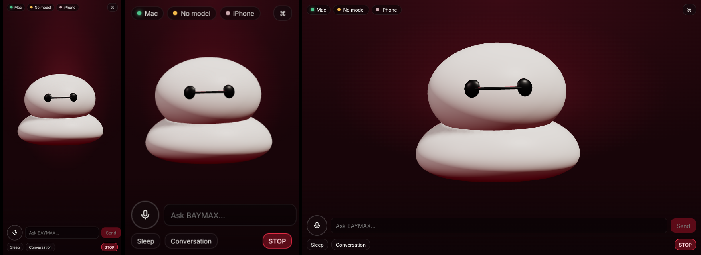

# BAYMAX — local-first AI companion for Mac and iPhone

BAYMAX is a personal assistant with an animated, original **Baymax-inspired healthcare robot**
companion. On the Mac it lives in a small floating window and the menu bar. On the iPhone it
stands on a deep-red stage. Behind the character is a local-first assistant that:

- holds conversations through a local model (Ollama),
- runs tasks only through a validated, risk-checked tool layer,
- builds 3D models, research reports, simulations and documents, and can repair code.

> The character is an original procedural model inspired by the broad look of Baymax from
> Disney's *Big Hero 6*. It is **not** an official Disney asset, and this project is not affiliated with Disney.



## What's in the repository

| Path | What it is | Tech |
|---|---|---|
| `protocol/` | Single source of truth for character states, the task lifecycle and every Mac↔iPhone message | JSON, shared by Python, TS and Swift |
| `backend/` | AI orchestration, tools, security, 3D engine, servers | Python 3.11+, aiohttp, numpy |
| `desktop/` | Mac app: floating companion, conversation window, engineering workspace, menu-bar tray | Electron, React, TypeScript, Vite, three.js |
| `ios/` | iPhone companion app and the `BaymaxKit` logic package | SwiftUI, SceneKit, Speech, CryptoKit |
| `scripts/` | `setup_mac.sh`, `test_all.sh`, Khronos GLB validation | bash / node |
| `docs/` | Setup, user guide, architecture, security, implementation report, limitations | |

## Quick start (Mac)

```bash
git clone <this repo> ~/Developer/BAYMAX && cd ~/Developer/BAYMAX
./scripts/setup_mac.sh          # Python venv, npm deps, Ollama + llama3.2:3b, whisper.cpp + model
cd desktop && npm start         # builds and launches the Mac app (it starts the backend itself)
```

The full guide is in [docs/SETUP.md](docs/SETUP.md), including iPhone build/install and pairing.
Day-to-day use is covered in [docs/USER_GUIDE.md](docs/USER_GUIDE.md).

## Status at a glance

| Area | State | Evidence |
|---|---|---|
| Python backend (tasks, policy, tools, servers) | Implemented, tested | 524 pytest tests pass |
| Shared protocol + state machines | Implemented in Python, TS, Swift | Parity tests in all three; Swift tests not executed here (no toolchain) |
| Mac app (Electron) | Implemented; launched on Linux (Xvfb) | Electron started, spawned the backend, rendered the character; not run on macOS here |
| Character + red theme | Implemented (three.js and SceneKit) | Screenshots above come from the real renderer driven by real backend states |
| iPhone app | Source complete; **not compiled in this environment** | 18 Swift files pass a syntax parse; CI config for macOS builds included |
| Local LLM (Ollama) | Integrated; no cloud fallback | Tested against a fake Ollama server; real Ollama not available here |
| Voice | whisper.cpp STT + `say`/AVSpeech TTS integrated | Pipeline unit-tested; real speech not run (no mic/engines here) |
| Desktop automation | macOS AppleScript/Quartz backend | Logic tested with a fake desktop; real macOS not available here |
| 3D creation | 31 generators, 220 request phrases (e.g. "sports car", "office chair", "hexacopter") | Every export passes BAYMAX validation and the Khronos glTF-Validator (124 files, 0 errors, 0 warnings) |
| Research | DuckDuckGo/SearXNG + SSRF-guarded fetch | Parsers tested on fixtures; live search blocked in this sandbox |
| Image generation | AUTOMATIC1111-API integration point | No generator available here; refuses honestly |

Remaining gaps are listed in [docs/LIMITATIONS.md](docs/LIMITATIONS.md). How everything was checked is in
[docs/IMPLEMENTATION_REPORT.md](docs/IMPLEMENTATION_REPORT.md).

The latest repair round is documented in [docs/FINAL_REPORT.md](docs/FINAL_REPORT.md): status of every acceptance test, plus launch,
permission and pairing steps. Related documents:

- [docs/AUDIT.md](docs/AUDIT.md): what was broken and why.
- [docs/VISUAL_SPEC.md](docs/VISUAL_SPEC.md): the shared design system.
- [docs/MANUAL_CHECKLIST.md](docs/MANUAL_CHECKLIST.md): the hardware checks only you can run.

## Design principles

- **Local first.** Ollama, whisper.cpp and the system voices. There is no cloud fallback, and paid APIs are not implemented.
- **The model proposes, code decides.** Language-model output is only ever a *proposal*. Tools validate their
  arguments and classify their own risk. A policy decides whether to allow, ask for approval, or deny.
- **Honest state.** The character shows what is actually happening. SUCCESS needs a verified outcome, and progress
  bars only move when a tool reports real progress.
- **Bounded everything.** Queues, timeouts, output sizes, model context, repair attempts and frame rates all have limits.

## Running the tests

```bash
./scripts/test_all.sh      # backend pytest, desktop typecheck + vitest + build, Swift when available
```
