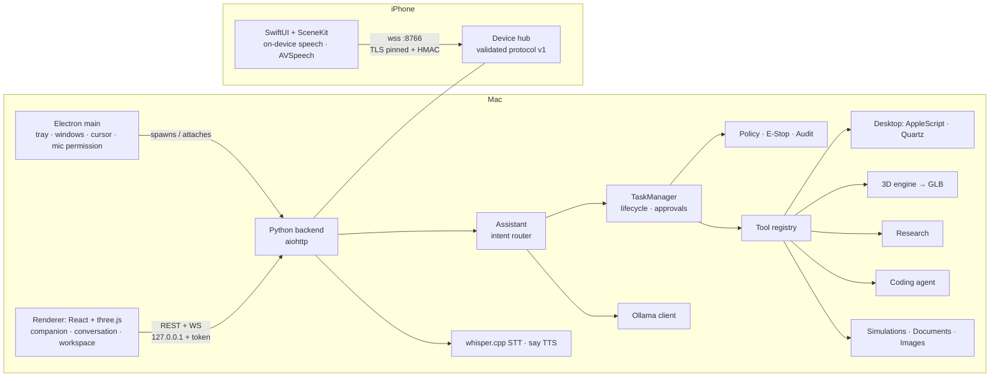

# Architecture

## Key decisions

| Decision | Why |
|---|---|
| **Electron + React + three.js** for the Mac | Requested stack. One codebase renders the companion, conversation and workspace. three.js gives a real-time 3D character and GLB viewer. |
| **Native SwiftUI + SceneKit** for the iPhone (not cross-platform) | Best fit for iOS microphone/speech permissions, on-device `SFSpeechRecognizer`, AVSpeech TTS, Keychain, background lifecycle and battery-aware rendering (`preferredFramesPerSecond`, Low Power Mode). SceneKit is on every iPhone and needs no asset pipeline. |
| **Python + aiohttp** backend | One process serves HTTP, WebSocket and TLS, with no framework sprawl. numpy for geometry/audio. sqlite (WAL) for persistence. |
| **Shared protocol JSON** | Character states and transitions, task lifecycle and message schemas live in `protocol/baymax-protocol.v1.json`. Python and Swift embed the tables, TS imports the file, and parity tests in all three load the JSON. |
| **Event-driven character state machine** | Components report *what happened* (mic started, task verified, connection lost). The machine decides the visible state, so animation can't drift from reality. SUCCESS requires `verified=True` and an EXECUTING predecessor. |
| **Backend-authoritative state + client overlays** | The Mac decides the character state. Each client overlays only what it alone knows: its own connection (DISCONNECTED), its own microphone (LISTENING), its own speech playback (SPEAKING). |
| **Rules first, model second** for intents | Commands are routed deterministically, which is fast, testable and works without a model. The model handles conversation and may *propose* a tool call, which is validated like any other request. |
| **Procedural 3D generators + validator** | Real, editable geometry for many object types, built from reusable primitives (box, rounded box, cylinder, cone, sphere, capsule, torus, lathe, extrude, loft, tube, helix, gear). Unsupported objects are refused rather than substituted. Every file is re-read and validated. |

## Backend modules (`backend/baymax/`)

| Module | Responsibility |
|---|---|
| `config.py`, `logging_setup.py`, `db.py`, `events.py` | settings (TOML + env), rotating logs, sqlite migrations, bounded event bus |
| `protocol/messages.py` | v1 envelope parsing/validation |
| `character/` | state machine (`state_machine.py`); authoritative controller with success display-hold (`controller.py`) |
| `security/` | pairing + HMAC auth, TLS cert, secrets (Keychain), policy, workspace confinement, command allowlist, audit chain, Emergency Stop |
| `tasks/` | task model + lifecycle transitions, TaskManager (policy, approvals, cancellation, progress, persistence, crash recovery) |
| `tools/` | tool base/registry; system tools (apps, desktop, files, commands, mail, hardware); creation tools |
| `hostos/` | macOS desktop backend (AppleScript via argv, Quartz events), bounded subprocess manager |
| `llm/` | Ollama client (streaming, timeouts, bounded context, no cloud fallback), prompts, model recommendations |
| `voice/` | WAV/VAD utilities, whisper.cpp recognizer, `say`/Piper speaker with real playback events |
| `memory/` | explicit user memory with sensitive-data filter; conversation log |
| `intent/router.py` | deterministic intent rules + validated model proposals |
| `creation3d/` | mesh primitives, scene spec, 31 generators, classifier, planner, modifier, GLB export, validator, versioned store |
| `research/`, `coding/`, `simulation/`, `documents/`, `images/` | creation subsystems |
| `assistant.py` | conversation orchestration, voice/sleep/estop handling, result replies |
| `server/` | local API (`app.py`) and LAN device hub (`hub.py`) |

## Task lifecycle

`REQUESTED → PLANNED → [AWAITING_APPROVAL] → RUNNING → VERIFYING → COMPLETED | FAILED | CANCELLED`

- Each step: validate args → classify risk → policy → (approval) → run → audit.
- Progress is only what tools report via `ctx.progress()`. When there is none, the UI shows an indeterminate bar
  labelled "no measurable progress reported".
- VERIFYING checks each step's `verified` flag, which tools set only after an actual check: a file re-read,
  GLB re-validation, process exit code, app-running query, or cursor read-back. Completed but unverified
  tasks show no success pose.
- After a crash or restart, unfinished tasks are closed as FAILED or CANCELLED with an explanation; they are
  never silently resumed.

## Performance on a 16 GB MacBook Air

- One generation at a time through a shared HTTP session. Context is capped at 4096 tokens and output at 512 by default.
- Bounded event queues that drop the oldest events, at most 2 concurrent tasks and 16 active tasks, and timeouts on every
  network call and subprocess.
- Character rendering is capped at 12–45 fps depending on state, and paused when the window is hidden. Pixel ratio
  is capped and shadow map size depends on quality.
- The model status poll runs every 30 s, or 10 s while unavailable, and reuses the connection.
